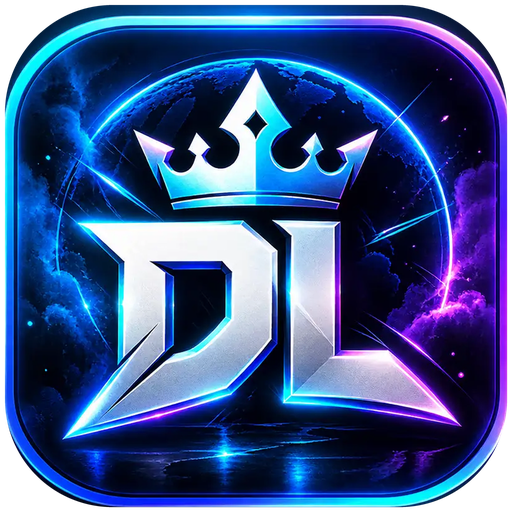

<!-- Copyright (c) 2026-2027 DominosLand by Capitanul Burcea-Alex. -->
<p align="center">
  
</p>

<h1 align="center">DominosLand</h1>

<p align="center">
  Ecosistemul DominosLand: jocuri, servere live, streaming, comunitate Discord și Jarvis AI.<br>
  Un singur cont, aceleași servere: pe DominosLand OS, pe calculator și pe telefon.
</p>

<p align="center">
  <a href="../../releases/latest"><b>⬇ Descarcă ultima versiune</b></a> ·
  <a href="https://dominosland.com">dominosland.com</a> ·
  <a href="https://panel.dominosland.com">Panou web</a>
</p>

<br>

## Produsele

### 💿 DominosLand OS

Un **sistem de operare separat**, construit pentru ecosistemul DominosLand. Nu este o aplicație și nu este launcherul.

<b>🚧 În pregătire.</b> Launcherul și aplicația de telefon de mai jos rulează pe sistemele existente; DominosLand OS va fi produsul de sine stătător.

### Aplicațiile

<table>
  <tr>
    <td width="50%" valign="top">
      <h3>🖥️ DominosLand Launcher</h3>
      <p>Aplicația desktop pentru Windows și Linux. Pornești jocurile, intri pe serverele DominosLand, faci live pe mai multe platforme deodată și salvezi clipuri, fără să schimbi aplicația.</p>
      <p><a href="../../releases/latest/download/DominosLand-Launcher-Setup.exe"><b>⬇ Windows 10 / 11 (64-bit)</b></a></p>
      <sub>Codul: <a href="apps/desktop">apps/desktop</a> · Electron + React + Vite</sub>
    </td>
    <td width="50%" valign="top">
      <h3>📱 DominosLand pentru telefon</h3>
      <p>Varianta mobilă a ecosistemului: serverele live, Jarvis AI, notificări pentru tichete și evenimente, contul tău DominosLand în buzunar.</p>
      <p><b>🚧 În lucru</b> · Android primul, apoi iOS</p>
      <sub>Planul: <a href="apps/mobile">apps/mobile</a> · Expo / React Native</sub>
    </td>
  </tr>
</table>

## Ce face launcherul

| Zonă | Ce găsești |
| --- | --- |
| **Acasă** | Serverele DominosLand live, cu intrare directă în joc. Biblioteca ta de jocuri, conturile conectate și comunitățile partenere. |
| **Streaming** | Multi-stream pe YouTube, Twitch, Kick, TikTok și alte platforme RTMP, cu un singur encoder. Cheile de stream rămân criptate pe calculatorul tău. |
| **Clipuri** | Replay buffer în fundal. Apeși **Alt+F10** și ultimele secunde de joc devin clip. |
| **Performanță** | Game Booster, test de ping către servere și detectarea encoderelor video (NVENC, AMF, QuickSync). |
| **Overlay** | Chat, tichete și Jarvis peste joc, fără Alt+Tab. Se deschide cu **Alt+J**. |
| **Cinema** | Vizionare curată, fără bare și reclame, cu captură de ecran din film. |
| **Jarvis** | Asistentul AI al comunității, direct din aplicație. |

Membrii staff-ului DominosLand văd în plus zona **Administrare**: Discord, Game Panel, servicii, loguri live, terminal, metrici VPS, domenii și audit de securitate. Toate acțiunile de acolo trec prin API-ul DominosLand, care verifică rolul contului. Aplicația singură nu poate executa nimic pe servere.

## Cum se leagă ecosistemul

```text
   ┌──────────────────┐   ┌──────────────────┐   ┌──────────────────┐
   │ DominosLand OS   │   │ Launcher (PC)    │   │ Telefon          │
   │ sistem de operare│   │ Windows / Linux  │   │ Android / iOS    │
   └────────┬─────────┘   └────────┬─────────┘   └────────┬─────────┘
            └──────────── HTTPS + WebSocket ──────────────┘
                                  ▼
                     api.dominosland.com (cont, roluri)
                                  │
         ┌────────────┬───────────┼────────────┬───────────────┐
         ▼            ▼           ▼            ▼               ▼
   Servere de    Bot Discord   Jarvis AI   panel.dominos-   dominosland.com
   jocuri                                  land.com
```

Acest repository conține deocamdată aplicațiile client: launcherul și aplicația de telefon. API-ul, botul, Jarvis și infrastructura serverului sunt în repository-ul privat al proiectului.

## Pentru dezvoltatori

```bash
cd apps/desktop
npm install
npm run dev      # aplicația cu reîncărcare live
npm run build    # verificare de tipuri + build
npm run dist     # installer-ul pentru sistemul tău
```

Implicit, aplicația vorbește cu `api.dominosland.com`. Pentru un API local, copiază `apps/desktop/.env.example` în `apps/desktop/.env`.

- Un release nou se face cu un tag `v*` (de exemplu `v1.1.0`). GitHub Actions construiește installer-ul și îl publică în [Releases](../../releases).
- Problemele de securitate se raportează privat, după [SECURITY.md](SECURITY.md).

<br>

<sub>© 2026-2027 DominosLand by Capitanul Burcea-Alex.</sub>
